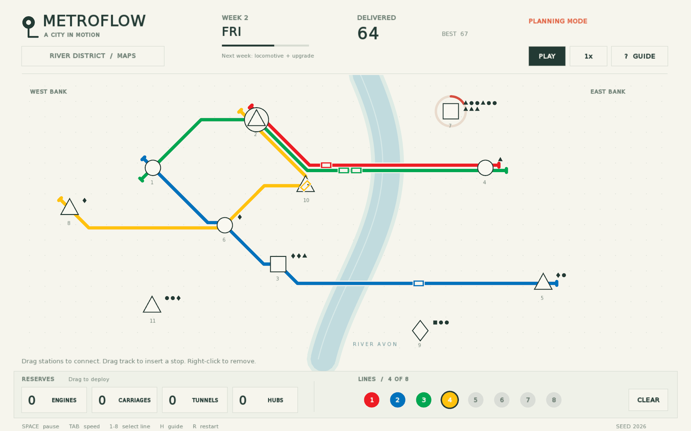

# MetroFlow

A metro-building strategy game in C++17 and SFML 3. Draw routes on two maps, carry passengers to matching station shapes, arrange transfers and keep stations from overcrowding. Weekly upgrades add trains, carriages, lines, tunnels and interchanges.



## Build and run on Linux

Requires a C++17 compiler, Git, CMake 3.28+ and OpenGL. On Debian/Ubuntu:

```bash
sudo apt install build-essential git cmake \
  libx11-dev libxrandr-dev libxcursor-dev libxi-dev \
  libudev-dev libfreetype-dev libgl1-mesa-dev
cmake -S . -B build -DCMAKE_BUILD_TYPE=Release
cmake --build build --parallel
./build/MetroFlow
```

CMake downloads SFML 3.0.2 on the first build and copies `assets/` beside the executable. Keep that folder beside the game. Run tests with `ctest --test-dir build --output-on-failure`.

## Controls

- Select a map, then a line colour (1–8). Drag between stations to build; drag track to insert a station. At most four lines can share a track section.
- Drag either T-bar to extend a route. Drag it back over the terminal station to remove that station; continue across earlier stops to shorten further. Join opposite ends to close a loop. Escape cancels an edit.
- Drag engines onto a route, carriages onto a train, and hubs onto a station. New engines start at the first station. Drag trains between routes; right-click a train to return it.
- Space pauses, Tab changes speed, H opens the guide, R restarts. Routes can be edited while paused. Your score is the number of passengers delivered.

`src/` and `include/` contain the game, `tests/` the model and interaction checks, and `assets/` the font and dependency licences. Code: [MIT](LICENSE). Independent project inspired by Mini Metro; no original game code or assets are used.
